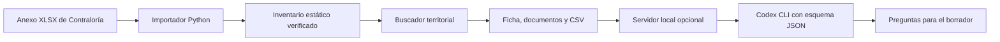

# Obras que esperan

## 1. One-liner

Ayudamos a periodistas, investigadores y estudiantes a encontrar obras públicas paralizadas y consultar quién está a cargo, con fichas y documentos del inventario oficial.

## 2. Founder

José Navarro. El producto parte de una investigación sobre obras paralizadas en el Perú y del trabajo previo de comunicar sus resultados mediante un tablero y un video. [Investigación previa](https://bocchienjoyer.github.io/obras.html)

## 3. Problema

Periodistas, investigadores y estudiantes que investigan una obra paralizada tienen que filtrar el anexo de Contraloría, identificar la entidad registrada y seguir los códigos en INFOBRAS y el MEF. Cada consulta implica cotejar registros entre esas fuentes. Está pendiente medir el tiempo y documentar tres conversaciones con usuarios potenciales. [Guía de entrevistas](docs/research/README.md)

## 4. Solución e insight

Un buscador territorial responde cuántas obras aparecen en el corte y cuáles son. Cada ficha muestra la entidad registrada, la unidad de control, los códigos de consulta y los enlaces documentales del anexo. Los filtros se pueden compartir por URL y el CSV conserva la fila, la fecha de corte y la fuente. Un borrador editable permite pedir información actualizada a la entidad.

## 5. Why now

El insumo para este producto es el anexo descargable del corte de junio de 2026. Sus códigos INFOBRAS y CUI permiten conectar el inventario de Contraloría con los portales oficiales. Los cortes anteriores ya existían. Hoy la revisión automatizada del compendio permite incorporar publicaciones posteriores, y el modelo con salida estructurada ayuda a preparar preguntas para solicitar información más reciente. La fecha de corte acompaña cada ficha y exportación.

## 6. Demo

Abre el [buscador público](https://bocchienjoyer.github.io/obras-que-esperan/) o la [versión local](dist/index.html) directamente en un navegador.

Para usar las sugerencias con IA, inicia sesión en Codex CLI, ejecuta `python servidor.py` en la raíz y visita [127.0.0.1:8000](http://127.0.0.1:8000). Abre una ficha y, dentro de **Preparar un pedido de información**, pulsa **Sugerir preguntas con IA**. La búsqueda, el CSV y el borrador editable funcionan también en la versión estática.

Ejemplo: selecciona **Cusco → La Convención → Echarate** o escribe **¿Cuántas obras paralizadas hay en Echarate?**. Abre una ficha, revisa la entidad y descarga el CSV filtrado. Usa **CUI 2100376** o **INFOBRAS 59** para consultar por código exacto. Los enlaces a informes y resoluciones provienen del anexo. Cada ficha abre directamente el registro de INFOBRAS y, cuando hay CUI, la inversión en el MEF. **Descargar resultados (CSV)** exporta todas las coincidencias, incluso las de otras páginas, con los campos de la ficha, las fechas de documentos disponibles y enlaces al anexo, a la ficha y a los registros oficiales. Los campos ausentes quedan vacíos.

[Buscador nacional](docs/capturas/01-buscador.png) · [Filtro territorial](docs/capturas/02-filtro-territorial.png) · [Ficha de obra](docs/capturas/03-ficha.png)

[Video de respaldo de 78 segundos](docs/video/demo.mp4). Muestra la búsqueda territorial, la descarga de resultados, una ficha real y las preguntas sugeridas con la IA local.

El navegador consulta el inventario local. El servidor usa el modelo predeterminado de Codex CLI con salida JSON estructurada para escoger preguntas de un catálogo cerrado. Le envía el avance y los indicadores del anexo necesarios para esa selección. Los identificadores, cifras y citas de la ficha se mantienen en el navegador. El modelo sugiere tres claves de una lista cerrada y el servidor valida que sean distintas.

Para instalar el lector de anexos, ejecuta `python -m pip install -r requirements.txt`. [GitHub Actions](.github/workflows/actualizar-inventario.yml) revisa el [compendio oficial](https://www.gob.pe/institucion/contraloria/colecciones/18230-obras-paralizadas-documentos) los lunes alrededor de las 8:17 a. m. de Perú. Valida el XLSX y publica solo cortes posteriores. Si cambia el formato o falla la fuente, se conserva el último inventario publicado. La página muestra la fecha del corte y la última revisión del compendio. Para comprobar el origen sin modificar archivos, usa `python scripts/actualizar_inventario.py --comprobar`.

Las pruebas de Python corren con `python -m unittest discover -s tests -v`. Para las pruebas de navegador, instala las dependencias con `npm install`, ejecuta `npx playwright install chromium` y luego `npm test`. La suite incluye clics repetidos, 20.000 registros sintéticos, fallos de carga y reintento de la IA. Para Firefox, instala ese navegador con Playwright y define `OBRAS_MOTOR=firefox`. La prueba que usa el modelo real se habilita con `OBRAS_IA_REAL=1`.

## 7. Modelo de negocio

La búsqueda es abierta. La hipótesis de pago es S/49 al mes por institución, dirigida a redacciones y organizaciones de investigación que quieran recibir alertas de nuevos cortes y seguir obras guardadas. Las alertas y el seguimiento son funciones propuestas. En el prototipo, buscar y exportar usa 0 tokens y el alojamiento estático actual en GitHub Pages tiene un costo directo de S/0 por usuario. Cada solicitud de preguntas hace una llamada al modelo de la sesión local de Codex del usuario. En una prueba con Matahuasi, Codex CLI reportó 16 415 tokens de entrada y 24 de salida para una solicitud que devolvió tres sugerencias válidas. Es una medición de una llamada y puede variar por modelo y sesión. El costo de alojar las alertas también queda por estimar.

## 8. Herramientas del curso

- **Ingesta web (sesión 03).** [preparar_datos.py](scripts/preparar_datos.py) descarga el anexo oficial, verifica su huella y prepara los campos de cada ficha.
- **Dashboards (sesión 05).** [buscador.js](dist/buscador.js) cruza los filtros, cuenta las obras y prepara la exportación.
- **LLM con salida estructurada (sesión 08).** [servidor.py](servidor.py) pide sugerencias con un esquema JSON y comprueba cada clave antes de agregar preguntas al borrador.

Referencias de diseño: búsqueda por entidad y ubicación en [INFOBRAS](https://www.gob.pe/es/10795-conocer-el-estado-de-las-obras-publicas-en-todo-el-peru-infobras), filtros territoriales de la [Consulta Avanzada del MEF](https://ofi5.mef.gob.pe/invierte/consultaPublica/consultaAvanzada) y búsqueda por identificador del [SSI](https://ofi5.mef.gob.pe/ssi/Ssi/Indexm).

## 9. Qué hizo el agente

Codex implementó la ingesta, el buscador, la ficha, la exportación, el borrador editable, las sugerencias locales y las pruebas automatizadas. El inventario inicial provino del Anexo 1 de Contraloría de junio de 2026. La página enlaza el informe y el anexo del corte vigente.
