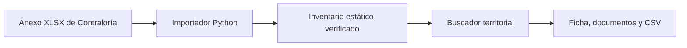

# Obras que esperan

## 1. One-liner

Ayudamos a periodistas, investigadores y estudiantes a encontrar obras públicas paralizadas y consultar quién está a cargo, con fichas y documentos del inventario oficial.

## 2. Founder

José Navarro. El producto parte de una investigación sobre obras paralizadas en el Perú y del trabajo previo de comunicar sus resultados mediante un tablero y un video. [Investigación previa](https://bocchienjoyer.github.io/obras.html)

## 3. Problema

Para investigar las obras paralizadas en un distrito hay que filtrar el inventario, identificar cada obra y ubicar documentos en distintos sistemas. La evidencia sobre el tiempo que toma hoy ese trabajo se recogerá en tres conversaciones con usuarios. [Guía de entrevistas](docs/research/README.md)

## 4. Solución e insight

Un buscador territorial responde cuántas obras aparecen en el corte y cuáles son. Cada ficha muestra la entidad registrada, la unidad de control, los códigos de consulta y los enlaces documentales del anexo. Los filtros se pueden compartir por URL y el CSV conserva la fila, la fecha de corte y la fuente. Un borrador editable permite pedir información actualizada a la entidad.

## 5. Why now

La Contraloría publica el inventario en formato reutilizable y lo vincula con documentación de Invierte.pe. El código INFOBRAS identifica la obra y el CUI facilita continuar la búsqueda de la inversión. La fecha de corte acompaña cada ficha y exportación.

## 6. Demo

Abre [el buscador local](dist/index.html) directamente en un navegador. Para servirlo desde HTTP, ejecuta `python -m http.server 8000 --directory dist` en la raíz y visita [localhost:8000](http://localhost:8000).

Ejemplo: selecciona **Cusco → La Convención → Echarate**, abre una ficha, revisa la entidad y descarga el CSV filtrado. En una ficha con documentos, abre el informe de estado situacional o la resolución. Para confirmar el estado posterior al corte, consulta INFOBRAS y el MEF usando los identificadores mostrados.

[Buscador nacional](docs/capturas/01-buscador.png) · [Filtro territorial](docs/capturas/02-filtro-territorial.png) · [Ficha de obra](docs/capturas/03-ficha.png)

El navegador consulta el inventario local. El borrador usa una plantilla con los campos oficiales. El importador se reproduce con `python -m pip install -r requirements.txt` y `python scripts/preparar_datos.py`.

## 7. Modelo de negocio

Hipótesis por validar: búsqueda abierta y suscripción institucional de S/49 mensuales por alertas de nuevos cortes y seguimiento de obras guardadas. La consulta actual usa cero tokens y el alojamiento sirve archivos estáticos. Las alertas son una hipótesis de producto.

## 8. Herramientas del curso

- **Ingesta web (sesión 03).** [preparar_datos.py](scripts/preparar_datos.py) descarga el anexo oficial, verifica su huella y prepara los campos de cada ficha.
- **Dashboards (sesión 05).** [buscador.js](dist/buscador.js) cruza los filtros, cuenta las obras y prepara la exportación.

Referencias de diseño: búsqueda por entidad y ubicación en [INFOBRAS](https://www.gob.pe/es/10795-conocer-el-estado-de-las-obras-publicas-en-todo-el-peru-infobras), filtros territoriales de la [Consulta Avanzada del MEF](https://ofi5.mef.gob.pe/invierte/consultaPublica/consultaAvanzada) y búsqueda por identificador del [SSI](https://ofi5.mef.gob.pe/ssi/Ssi/Indexm).

## 9. Qué hizo el agente

Codex implementó la ingesta, el buscador, la ficha, la exportación y el borrador editable. Los registros provienen del Anexo 1 de Contraloría de junio de 2026.
